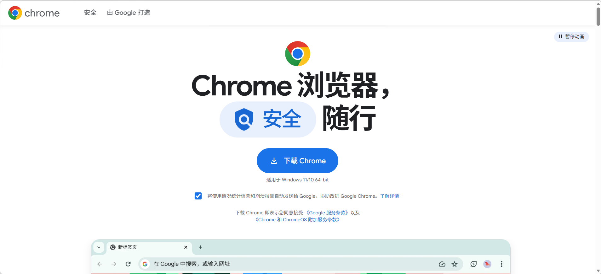
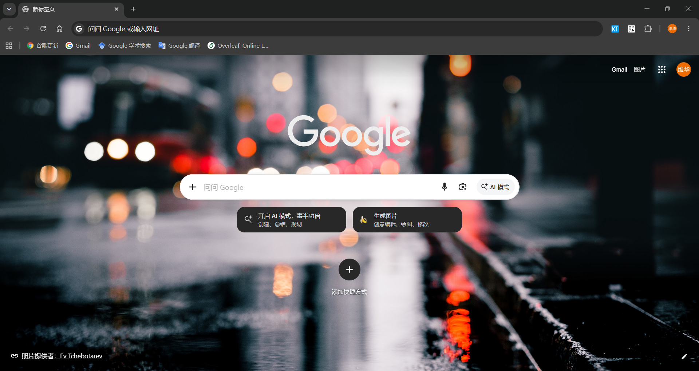
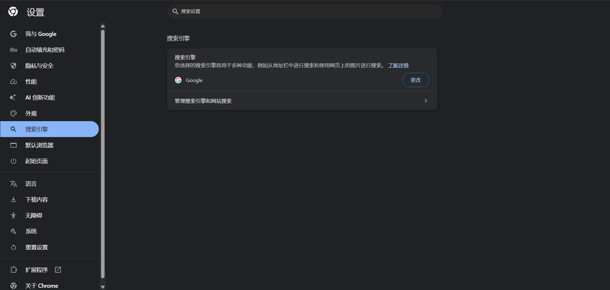
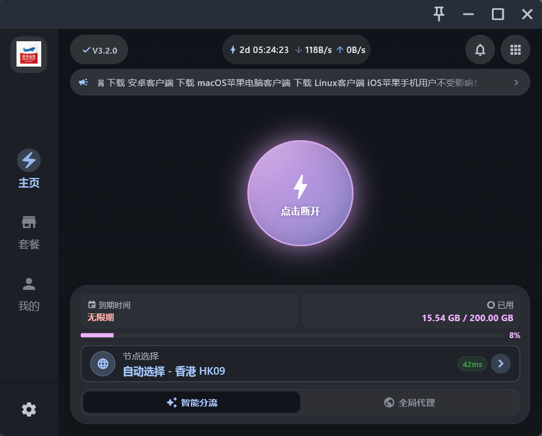

# Google Chrome

> 搜索引擎，广告较少，搜索内容更真实准确，插件丰富。
> 主要用途：浏览国外网站，例如AI工具（Chat GPT）、GitHub、学术论文搜索（scholar）、Google翻译等
> 维护人：童维华｜最后更新：2026 年 10 月 21 日

## 下载与安装
地址：https://www.google.com/chrome/
直接下载符合自己电脑的版本，按步骤安装在非C盘即可

运行界面如下。一般情况下，可以不用设置为默认浏览器，但是使用时需要在**设置**->**搜索引擎**中将搜索引擎更改为**Google**。

## VPN（代理）
使用Google需要科学上网，也就是开VPN，俗话翻墙

一般的VPN工具都是付费的，比如**clash for Windows**，需要去买订阅，网上有免费的订阅链接，但是不稳定。

订阅分为按周期和按流量，按周期比如每月15元限流200G，按流量比如45元200G不限时长。我个人推荐买流量不限时的，除非每天高强度翻墙冲浪。

**Clash for Windows**说是已经停止维护，但是还能用，因为它本身只是一个客户端，翻墙主要是通过**代理节点**完成的，而代理节点的配置文件通过购买订阅就可以获得。详情看官方文档：https://clashknowledge.com/zh-CN/blog/articles/clash-windows-install-windows-10-2026.html

网上的VPN很多，注意识别真假，广告弹窗是否频繁，节点是否稳定，以及价格对比。我自已使用的是**农夫山泉**，在v1.x版本的时候很便宜，15元买了200G不限时，半年了只用了一点，现在已经45元了。不过一个账号可以登录多设备（基本上所有设备都支持），也可以多人同时登陆，所以推荐几个人拼单。也可以找找别的VPN软件。

网址：https://web01.nfsqapp.cc/#/login
