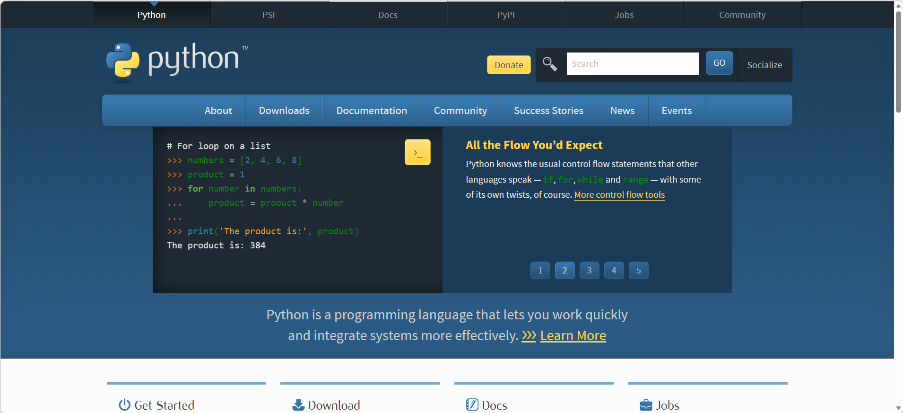
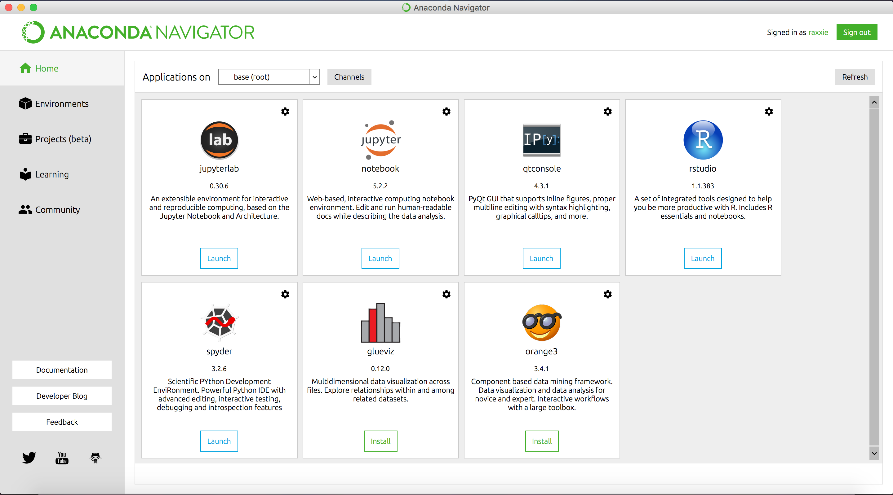

# Python
> 目前世界最主流的编程语言，使用该语言需要具备 **Python解释器** + **编程IDE**
>
> 维护人：童维华｜最后更新：2026 年 10 月 15 日
## Python解释器（Python环境）
1. 官网直接安装Python：https://www.python.org/
   - 建议：一般不推荐
   - Python具有大量的第三方库（例如numpy，pandas，pytorch等等），在编程过程中经常会调用，需要相关的工具管理安装的工具库。经常会根据项目创建相应的Python虚拟环境，在虚拟环境内只需安装项目相关的工具库，因此也需要对虚拟环境进行管理
   - 安装教程：https://blog.csdn.net/sensen_kiss/article/details/141940274

2. Anaconda：https://www.anaconda.com/download
   - 建议：功能强大但冗余
   - 便于进行Python环境和工具库管理，同时内嵌PyCharm、jupyterlab、spyder等IDE
   - 介绍、安装、使用教程：https://zhuanlan.zhihu.com/p/32925500
  
3. miniconda：https://www.anaconda.com/docs/getting-started/concepts/anaconda-or-miniconda
   - 建议：如果使用VS Code作为IDE，推荐使用
   - Anaconda的缩小版，没有图形界面，只有环境和库管理工具
   - 安装教程：https://blog.csdn.net/ming12131342/article/details/140233867
   
## 编程IDE
本质上是编写代码和运行程序的工具，尽可能选择符合自己审美和项目管理习惯的IDE。就我个人而言
- **PyCharm**：对于新手来说非常好用，界面简单，有智能补全，错误高亮，内建开发者工具等等，但是可能会卡
- **jupyterlab**：可以运行.ipynb，允许将代码分成多个单元或逐块执行，便于查看中间结果，适合分析数据、绘图
- **VS Code**：拥有丰富的插件，具备基础的代码补全、高亮等功能，安装AI Coding助手实现智能编码、代码分析、bug查找与修复等等，也可以安装jupyter插件运行.ipynb，便于使用GitHub管理项目