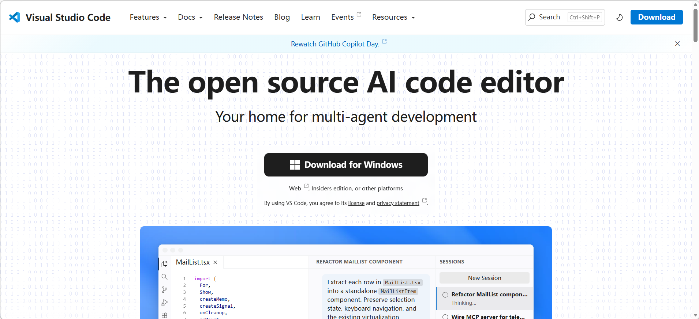
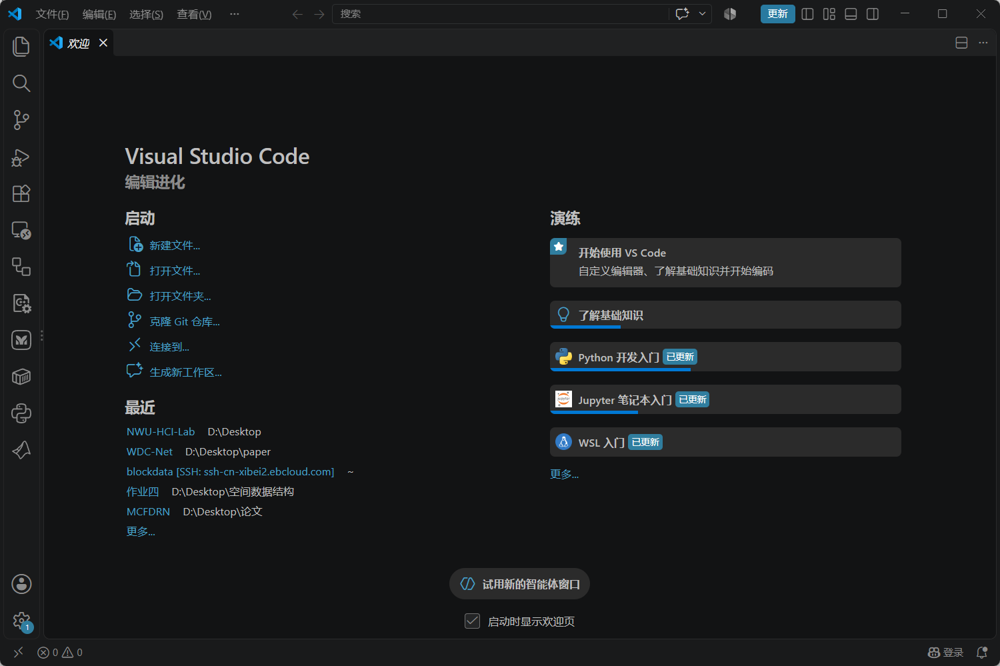
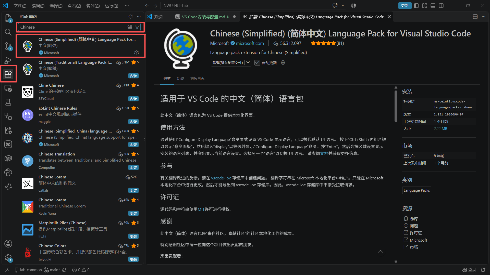
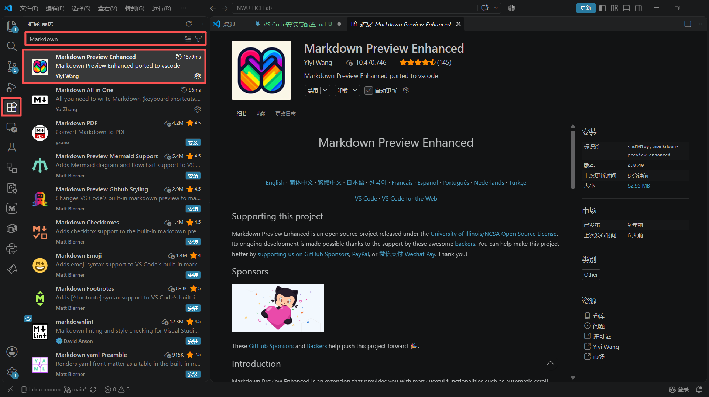

# VS Code
> 最实用的工具没有之一，主要功能写代码、跑程序；进行文档撰写和预览（markdown、Latex等等）；与Github仓库同步；插件众多，可以接入AI助手
>
> 维护人：童维华｜最后更新：2026 年 10 月 15 日

**目录**
- [VS Code](#vs-code)
  - [下载与安装](#下载与安装)
  - [安装插件](#安装插件)

## 下载与安装
官网：https://code.visualstudio.com/
下载电脑支持的版本，安装路径选择非C盘

安装成功后运行VS Code，界面如下

## 安装插件
1、中文插件（英文无障碍可跳过）
- 打开扩展，在搜索框搜索**Chinese**
- 选择中文（简体），勾选自动更新，点击"Install"，安装成功后重启VS Code

2、Markdown编辑与预览
- 在扩展中搜索**Markdown**，安装**Markdown Preview Enhanced**
- 选择性安装**Markdown All in One**，写 Markdown 时的快捷键和自动化工具集
