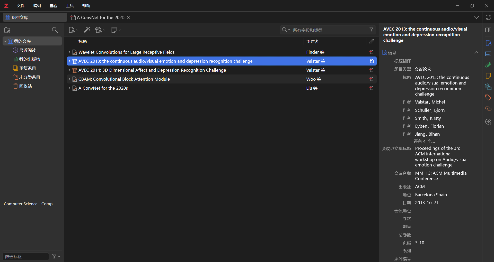
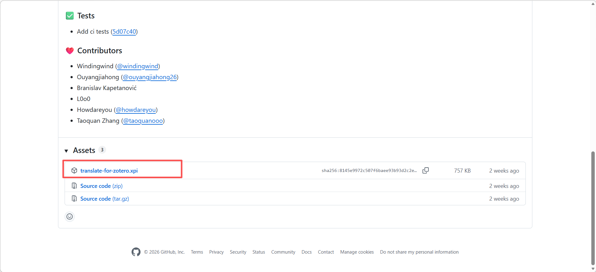
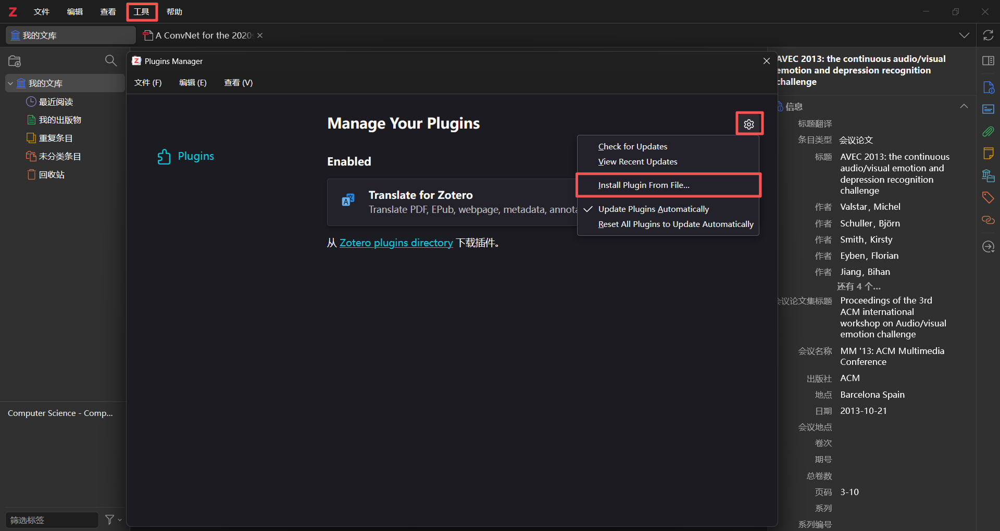
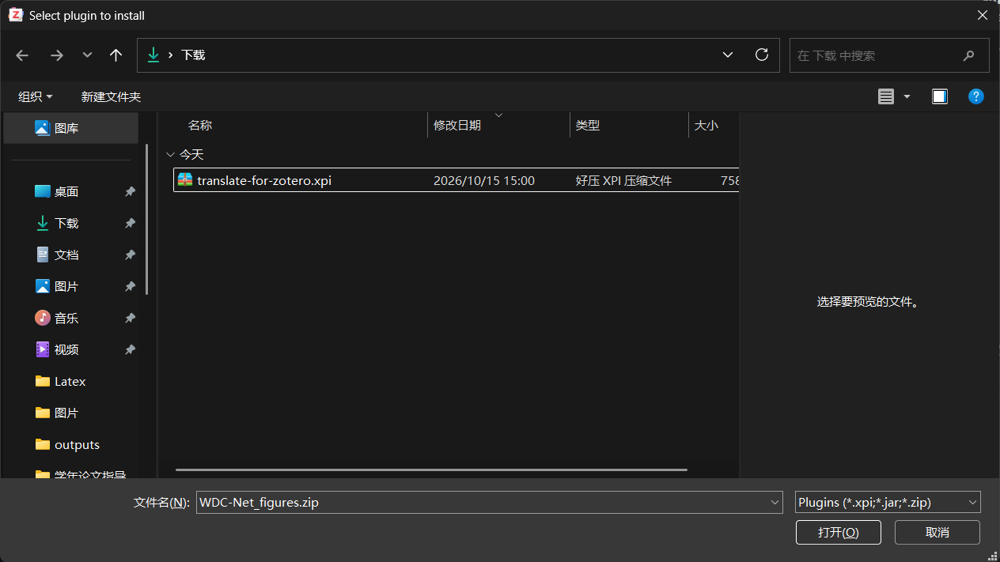
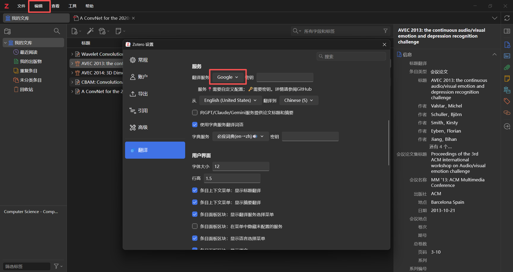

# Zotero
> 文献管理与阅读工具
> 
> 维护人：童维华｜最后更新：2026 年 10 月 21 日

## 下载与安装
官网：https://www.zotero.org/
下载电脑支持的版本，安装路径选择非C盘

运行界面

## 翻译插件zotero-pdf-translate
1. 安装插件
下载地址：https://github.com/windingwind/zotero-pdf-translate/releases/tag/v2.4.8
下滑至底部，点击**translate-for-zotero.xpi**下载插件压缩包

在Zotero菜单栏点击工具按钮，选择插件选项进入插件安装界面，点击设置按钮选择**Install Plugin From File...**选项，打开下载的插件压缩包

2. 设置插件
在Zotero菜单栏点击编辑按钮，选择设置选项进入设置界面，点击翻译插件，设置翻译服务

如果选择**Google**作为翻译服务，那么需要安装Google Chrome浏览器，不用填写密钥，但是在翻译过程中需要打开VPN代理。详细操作见**Chrome.md**